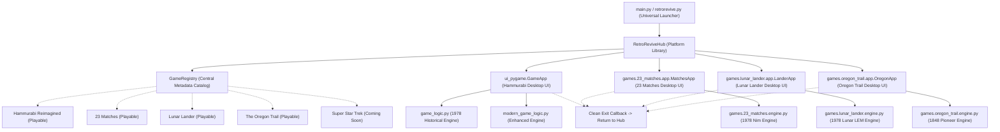

# RetroRevive — Platform Architecture Specification

**Event:** Confluence Buildathon 2026  
**Track:** Resurrections  
**Core Stack:** Python 3 (Standard Library Engine) + Optional Pygame Desktop UI

---

## 1. Architectural Vision

RetroRevive is designed as a modular, extensible desktop platform that resurrects verified historical computer games through polished modern interfaces while preserving their original gameplay rules in strictly verified Classic Modes.

Rather than a monolithic single-game implementation or a brittle collection of disparate scripts, RetroRevive employs a **Registry-Driven Multi-Game Architecture**:



---

## 2. Directory Layout

```
RetroRevive/
├── main.py                     # Universal entry point (Platform, GUI games, CLI fallback)
├── retrorevive.py              # Graphical Game Library Hub (Catalog, search, category filters)
├── game_registry.py            # Central Game Registry & metadata catalog
├── ui_theme.py                 # Shared UI system (typography, palettes, sound synthesis)
├── ui_world.py                 # Hammurabi animated Sumerian landscape
├── ui_pygame.py                # Hammurabi Reimagined desktop application
├── game_logic.py               # Hammurabi authoritative 1978 historical engine
├── modern_game_logic.py        # Hammurabi enhanced mode (Advisors, Scenarios, Chronicle)
├── presentation.py             # Hammurabi ANSI terminal visualizer
├── games/
│   ├── __init__.py             # Games package loader & cross-game aliases
│   ├── 23_matches/
│   │   ├── __init__.py         # Package exports
│   │   ├── engine.py           # Pure Python standard-library 23 Matches rule engine
│   │   ├── app.py              # Pygame desktop UI with animated matchstick board
│   │   └── test_engine.py      # Automated tests for 23 Matches rules and AI (16 tests)
│   ├── lunar_lander/
│   │   ├── __init__.py         # Package exports
│   │   ├── engine.py           # Pure Python standard-library Lunar Lander simulation
│   │   ├── app.py              # Pygame desktop UI with Apollo LEM & telemetry dashboard
│   │   └── test_engine.py      # Automated tests for burn physics and landing tiers (17 tests)
│   └── oregon_trail/
│       ├── __init__.py         # Package exports
│       ├── engine.py           # Pure Python standard-library 1848 pioneer simulation
│       ├── app.py              # Pygame desktop UI with animated wagon & trail dashboard
│       └── test_engine.py      # Automated tests for travel, river, store & scoring (20 tests)
├── test_game.py                # Historical Hammurabi unit tests (26 tests)
├── test_modern.py              # Enhanced Hammurabi unit tests (7 tests)
├── test_ui.py                  # Hammurabi UI unit tests (27 tests)
├── test_platform.py            # Platform Hub, Registry, and Navigation tests (31 tests)
├── verify_ui.py                # Headless visual verification & screenshot generator
├── docs/
│   ├── platform-architecture.md# Platform design and extensibility guide
│   ├── game-sources.md         # Historical provenance and licensing attribution
│   ├── lunar-lander-rules.md   # Mathematical derivation, physics, and landing tiers
│   ├── oregon-trail-rules.md   # 1848 route map, landmark guide, math, health equations
│   └── screenshots/            # Verified visual outputs across resolutions
```

---

## 3. Core Subsystems

### 3.1. Central Game Registry (`game_registry.py`)
The `GameRegistry` acts as the single source of truth for all games supported by RetroRevive. Each game is described by a `GameMetadata` record:
- **Identifier:** Unique, immutable string key (`hammurabi`, `23_matches`, etc.).
- **Provenance:** Author, original publication year, publisher, source literature citation.
- **Classification:** Category (`STRATEGY_SIMULATION`, `PUZZLE_LOGIC`, `ADVENTURE_SPACE`), tags.
- **Availability:** `PLAYABLE` or `COMING_SOON`.
- **Game Modes:** List of supported modes (e.g., Classic 1978, Master Mind, Scenarios).
- **Rules Summary:** Concise domain rules for the Detail Modal and player guidance.

The registry provides dynamic query methods:
```python
registry.list_all()
registry.list_playable()
registry.filter_by_category(GameCategory.STRATEGY_SIMULATION)
registry.search("nim")
```

### 3.2. Single-Window Lifecycle & State Isolation
To prevent window flicker, SDL driver resets, or multi-process crashes on Windows desktop environments, RetroRevive executes all games inside a **Shared Window Controller**:
1. `RetroReviveHub` initializes the Pygame display window at $1280 \times 720$ (resizable).
2. When launching a game (e.g. Hammurabi or 23 Matches), the hub instantiates the game's app controller, passing:
   - `shared_window=self.window` (reuses the active surface)
   - `on_exit_to_library=self._return_to_hub` (callback invoked upon quitting)
3. The hub assigns `self.active_subapp = subapp` and delegates all `handle_event()`, `update()`, and `draw()` calls to the active game.
4. When the player clicks "← LIBRARY" or exits the game, `on_exit_to_library()` is called, setting `self.active_subapp = None`. The library hub is immediately restored without state leakage or recreation of the OS window.

### 3.3. Pure Separation of Rules and Presentation
Every game in RetroRevive adheres to the architectural mandate that **simulation calculations must be 100% decoupled from graphics**:
- `game_logic.py` and `games/23_matches/engine.py` use **only the Python standard library**.
- Game engines can be imported and verified independently of Pygame, terminal color sequences, or audio drivers.
- Both games provide deterministic terminal CLI runners for environments without GUI support.

---

## 4. How to Add a New Game to RetroRevive

Adding a new retro game requires three simple steps:

### Step 1: Implement the Game Rule Engine
Create a new directory in `games/<game_id>/` (e.g. `games/lunar_lander/`):
- `engine.py`: Pure Python dataclasses and functions (`init_game()`, `make_move()`, `step()`).
- `test_engine.py`: Unit tests verifying valid inputs, illegal inputs, edge cases, and repeatable scenarios.

### Step 2: Implement the Desktop Interface
Create `games/<game_id>/app.py`:
- Accepts `shared_window: Optional[pygame.Surface]` and `on_exit_to_library: Optional[Callable[[], None]]`.
- Renders to a $1280 \times 720$ canvas with aspect-ratio letterboxing.
- Provides a "← LIBRARY" button that invokes `on_exit_to_library()`.

### Step 3: Register in `game_registry.py`
Add a new `GameMetadata` entry into `CATALOG`:
```python
"lunar_lander": GameMetadata(
    game_id="lunar_lander",
    title="LUNAR LANDER",
    subtitle="Apollo 11 Lunar Module Descent Simulator",
    year=1973,
    author="Jim Storer (1969), David H. Ahl (1973)",
    original_publisher="DEC / Creative Computing",
    category=GameCategory.STRATEGY_SIMULATION,
    category_display="Strategy & Simulation",
    status=GameStatus.PLAYABLE,
    modes=["Classic 1973 Mode"],
    description="Pilot the Apollo lunar excursion module safely to the moon...",
    rules_summary="Burn fuel every second to counteract gravity...",
    historical_provenance="Created in 1969 by Jim Storer; published in 101 BASIC Computer Games.",
    book_source="BASIC Computer Games (1978), pp. 106-108.",
    tags=["Space", "Physics", "Apollo"],
)
```
Add routing in `retrorevive.py`:
```python
elif game_id == "lunar_lander":
    self.active_subapp = lander_app.LanderApp(
        shared_window=self.window,
        on_exit_to_library=self._return_to_hub,
    )
```

The game card immediately appears in the platform library, category tabs, and search results!
